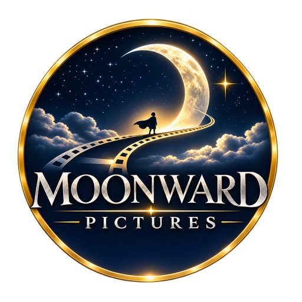

  

<h1 align="center">Moonward Pictures</h1>

<em>Every story begins with a dream.</em>

Moonward Pictures is an independent creative studio bringing original stories to the screen, from magical adventures and imaginative worlds to heartfelt, deeply human drama.

## What we do

**Cinematic storytelling.** Original short- and long-form films, led by story and craft.

**AI-assisted production.** We build and test workflows in which emerging tools support the filmmaking process, with artistic direction and human review at every step.

**Creative experimentation.** We try new ways of taking a story from the page to the screen, and keep what serves the film.

## On GitHub

This is where we will share the tools, experiments, and workflows behind our films as they become ready for release.

## Follow our journey

Watch our films and follow along on [YouTube](https://www.youtube.com/@MoonwardPictures).
